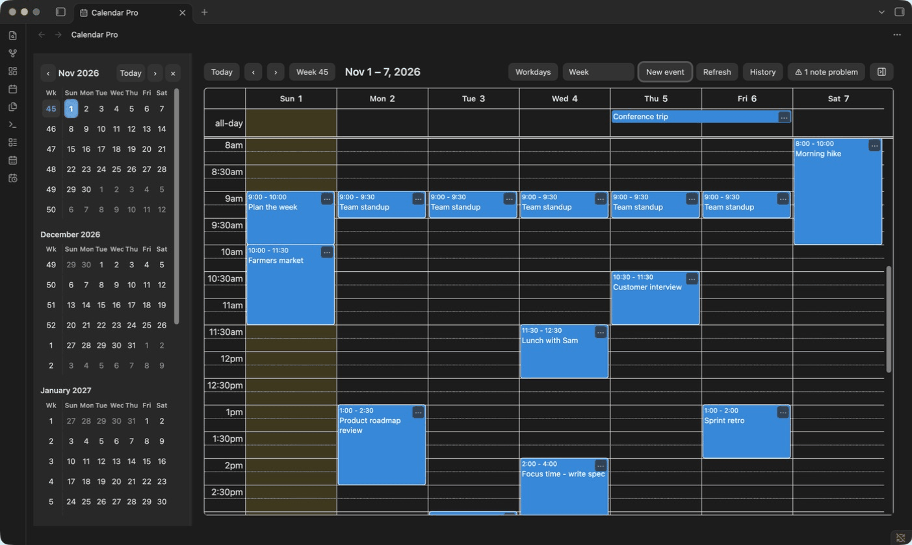
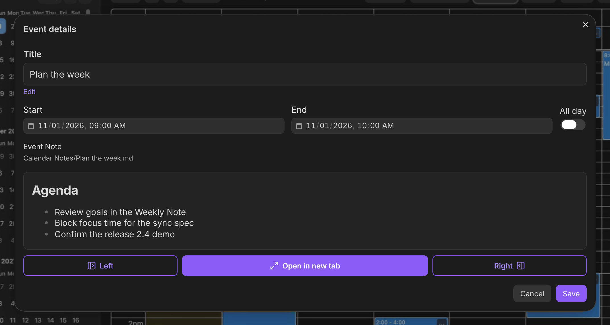
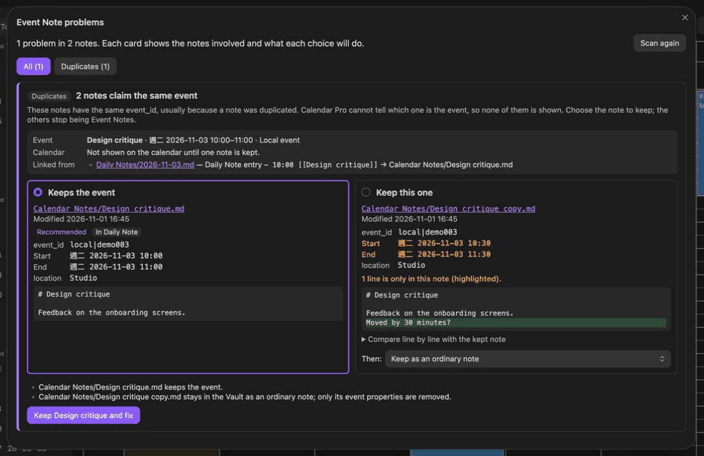

# Calendar Pro

A calendar for Obsidian that keeps your events as Markdown notes in your Vault.



## Highlights

- **Events are notes.** Each local event is an Event Note with `start` and `end` in its properties, linked from the Daily Note for its date. Subscribed events get an Event Note when you open them. Drag an event to another day and its Daily Note entry moves with it.
- **Six views.** Week, Day, Month, Year, Custom days, and List, plus a mini calendar for jumping between dates. Click a date header for its Daily Note or a week number for its Weekly Note.
- **Your schedule beside your notes.** An events sidebar shows a phone-style day timeline or a two-week list, and a month calendar sidebar marks event days and existing Daily Notes.
- **Calendar subscriptions.** Add read-only HTTPS or `webcal://` feeds next to your local events. Holiday calendars shade their days.
- **Finds and fixes note problems.** When a copied note duplicates an `event_id`, **Review Event Note problems** shows the copies side by side, highlights the differences, recommends which to keep, and applies the fix you choose. Notes with broken properties can be restored to their last valid version.
- **Projects as Gantt charts.** Open a note's outline as a WBS table or a Gantt chart. Dates, progress, and assignees live in brackets at the end of each line, such as `(30%, 11/1-11/6, @小王)` or `@[[小王]]` / `[[@小王]]` for a linked person, and dated tasks appear in the calendar. See [Projects and Gantt](docs/manuals/USER-GUIDE.md#projects-and-gantt).
- **Local and private.** No account or telemetry. The only network requests fetch the feeds you add. See [privacy and compatibility](docs/manuals/USER-GUIDE.md#privacy-and-compatibility).

| Event details | Event Note problems |
| --- | --- |
|  |  |

## Install

Calendar Pro needs desktop **Obsidian 1.14.5 or later**. It is not in the Community Plugins directory yet.

- **ZIP:** [download the latest release](https://github.com/rightson/obsidian-calendar-pro/releases/latest/download/calendar-pro.zip) and follow the [installation guide](docs/manuals/INSTALLATION.md), which also covers updates.
- **BRAT:** install BRAT from Community Plugins, then add `rightson/obsidian-calendar-pro` as a beta plugin ([BRAT steps](docs/manuals/INSTALLATION.md#install-with-brat)).
- [All releases](https://github.com/rightson/obsidian-calendar-pro/releases)

Open the calendar from the ribbon icon or the command palette, then see the [user guide](docs/manuals/USER-GUIDE.md) for clicking, sidebars, subscriptions, holiday calendars, and where Event Notes are saved.

## Contributing

Bug reports and pull requests are welcome. You need Node.js 22 or newer, npm, and `zip`.

```sh
git clone https://github.com/rightson/obsidian-calendar-pro.git
cd obsidian-calendar-pro
npm ci
npm run dev -- /absolute/path/to/test-vault
```

`npm run dev` rebuilds into the Vault's plugin folder on every save. The path must be absolute and point to a Vault Obsidian has already opened, so it has a `.obsidian` folder. With the [Hot Reload](https://github.com/pjeby/hot-reload) plugin installed there, Obsidian reloads Calendar Pro after each build. Use a test Vault, not your real one.

Before opening a pull request:

```sh
npm run typecheck
npm test
npm run package
```

Where things live:

| Area | Files |
| --- | --- |
| Plugin entry, commands, settings | `src/main.ts`, `src/settings.ts`, `src/settings-tab.ts` |
| Main calendar and mini calendar | `src/calendar-*.ts` |
| Events sidebar and month calendar sidebar | `src/agenda-*.ts`, `src/months-*.ts` |
| Event Notes and Daily/Weekly Notes | `src/events.ts`, `src/notes.ts`, `src/paths.ts` |
| Event details dialog, event actions, change history | `src/modals.ts`, `src/event-actions.ts`, `src/history.ts` |
| Subscriptions and holiday calendars | `src/ical*.ts`, `src/subscription*.ts`, `src/sync.ts`, `src/holidays.ts` |
| Event Note problems | `src/note-problems.ts`, `src/problems-modal.ts` |
| Gantt view and Project Notes | `src/gantt-view.ts`, `src/annotation.ts`, `src/tasks.ts`, `src/task-hints.ts`, `src/project-*.ts` |
| Saved state and crash recovery | `src/store.ts`, `src/state.ts`, `src/vault-adapter.ts` |
| Shared types and date/week helpers | `src/types.ts`, `src/date.ts` |
| Tests (Node test runner) | `tests/*.test.ts` |

Ways to help:

- **Native QA.** Several features have automated coverage only. The [native test checklist](docs/manuals/DEVELOPMENT.md#native-obsidian-test-vault-checklist) lists what to check in a real Obsidian Vault.
- **Mobile.** Calendar Pro is desktop-only because mobile has not been tested.

See [development and QA](docs/manuals/DEVELOPMENT.md) for the full build, install, and test notes, and [releasing](docs/manuals/RELEASING.md) for packaging a release.

## License

[MIT](LICENSE). Third-party licenses are embedded in the release `main.js` and included as `THIRD_PARTY_LICENSES.txt` in the ZIP. See the [0.2.1 release notes](docs/releases/0.2.1.md) for this version's verified scope and known limits, and [all release notes](docs/releases/) for earlier versions.
