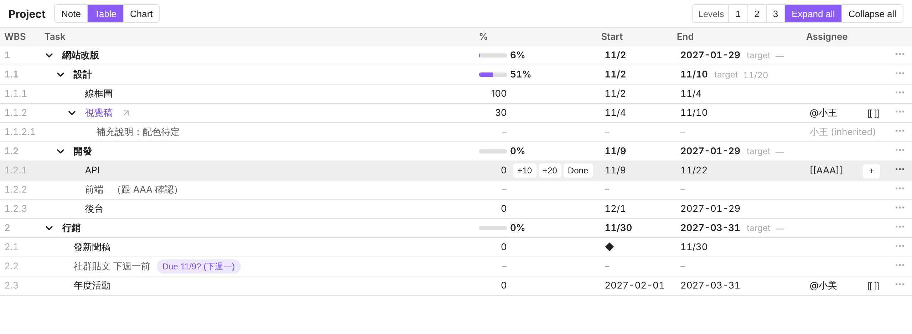
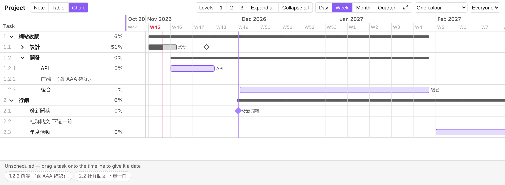

# Gantt quick start

Turn any outline into a project plan. The note holds everything: dates, progress, and assignees go in brackets at the end of each line.

## 1. Open a note as a Gantt

Write an outline, then open it as a Gantt in one of three ways:

- Click the chart button in the note's title bar.
- Run **Open current note as Gantt** from the command palette.
- Right-click the file and choose **Open as Gantt**.

```
- 網站改版
  - 設計 (11/20)
    - 線框圖 (100%, 11/2-11/4)
    - 視覺稿 (30%, 11/4-11/10, @小王)
  - 開發
    - API (11/9-11/22, by [[AAA]])
    - 前端
- 行銷
  - 發新聞稿 (◆ 11/30)
```

Every line becomes a row, and indentation sets the hierarchy. A row with tasks below it is a summary row. It takes its dates and progress from those tasks.

## 2. Add dates and progress

| At the end of a line | Meaning |
|---|---|
| `(11/6)` | Deadline |
| `(11/1-11/6)` | Start and end |
| `(30%)` | Progress (a ticked `- [x]` is 100%) |
| `(◆ 11/30)` | Milestone |
| `(@小王)` or `(by [[小王]])` | Assignee, inherited by the rows below |

You can combine them: `(30%, 11/1-11/6, @小王)`. Full-width brackets work too, as in `（30％，11/6）`. Brackets that contain anything else, such as `（跟 AAA 確認）`, are left alone as your own remark.

You don't have to type the brackets. Edit a cell in **Table**, or drag a row from **Unscheduled** onto the timeline in **Chart**, and the plugin writes them for you. The first time it changes a note, it shows you a preview and adds `gantt: true` to the note's properties.

## 3. Track progress

- **Table:** every cell reads as plain text until you click it. Type and press Enter. Point at a row, or tab into it, to show **+10**, **+20**, and **Done** beside the %. On a touch screen, tap the % instead. Every change offers **Undo**.
- **Chart:** drag a bar to move it, or drag either end to change its dates. A date written on a summary row is that branch's target. The target turns red when a task below finishes later.
- **Calendar:** dated tasks appear in the all-day row in their own dark colour. Click one to schedule time for it that day as an Event Note, or to jump to its line in the note.



## 4. Rename, fold, and zoom

- **Rename:** click a task's name in Table or in the Chart's Task column. Only the name changes. Remark brackets after it, the dates and progress, and any `^id` stay as written. If the task links to its own Task Note, the note itself is renamed and Obsidian updates the links to it.
- **Fold:** click the arrow beside a row. Alt-click (Option-click on a Mac) opens or closes everything below it. **Levels 1 / 2 / 3** show that many levels, and **Expand all** / **Collapse all** do the rest. A collapsed branch still shows its full date range in Chart.
- **Zoom:** choose **Day**, **Week**, **Month**, or **Quarter**, or hold Ctrl (Cmd on a Mac) and scroll over the chart. The ⤢ button fits the whole project on screen. Dragging still moves bars by whole days.
- **Task column:** drag its right edge to make it wider or narrower. Double-click the edge to reset it.

The Gantt view remembers folding, zoom, and the column width for each Gantt tab, never in the note.



## More

You can also promote a line to its own Task Note, create person notes for assignees, and accept date suggestions for words such as 下週一. For every rule, see [Projects and Gantt](USER-GUIDE.md#projects-and-gantt).
